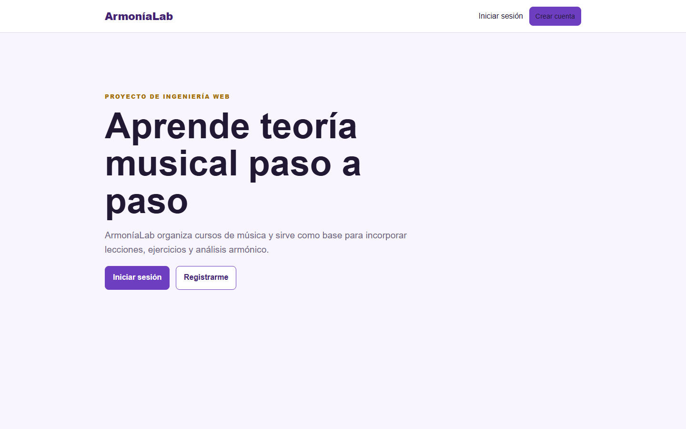

# ArmoníaLab


ArmoníaLab es una aplicación académica desarrollada con Laravel 12. Este primer avance demuestra el patrón MVC, autenticación y un CRUD protegido de cursos musicales. Es la base del proyecto semestral descrito en la propuesta general.



## Índice

- [Estado del proyecto](#estado-del-proyecto)
- [Funcionalidades](#funcionalidades-de-este-avance)
- [Tecnologías](#tecnologías)
- [Instalación](#instalación)
- [Demostración](#demostración)
- [Arquitectura MVC](#arquitectura-mvc)
- [Pruebas](#pruebas)
- [Integrantes](#integrantes)
- [Licencia](#licencia)

## Estado del proyecto

El proyecto se encuentra **en desarrollo**. El primer avance de autenticación y CRUD de cursos está terminado y probado. Los siguientes avances incorporarán lecciones, ejercicios y funcionalidades de análisis musical.

## Funcionalidades de este avance

- Registro, inicio y cierre de sesión.
- Protección de todas las URL de cursos mediante el middleware `auth`.
- CRUD completo de cursos: crear, listar, consultar, editar y eliminar.
- Autorización por propietario: cada usuario solo administra sus cursos.
- Validación de formularios mediante `CourseRequest`.
- Interfaz responsive hecha con Blade y CSS básico.
- Datos de demostración y pruebas automáticas de autenticación, seguridad y CRUD.

## Tecnologías

- PHP 8.2 o superior
- Laravel 12
- SQLite por defecto
- Blade, HTML y CSS
- PHPUnit

## Instalación

### Opción recomendada con Visual Studio Code y Docker

Esta opción no requiere instalar PHP ni Composer directamente en Windows.

1. Instala y abre Docker Desktop.
2. Abre Visual Studio Code.
3. Selecciona **File → Open Folder** y abre la carpeta de ArmoníaLab.
4. En Visual Studio Code selecciona **Terminal → Run Task**.
5. Elige **ArmoníaLab: levantar proyecto**.
6. Espera hasta ver el mensaje `Server running on`.
7. Abre `http://127.0.0.1:8000` en el navegador.

Para apagar la aplicación, vuelve a **Terminal → Run Task** y elige **ArmoníaLab: detener proyecto**.

También se puede iniciar desde la terminal integrada:

```powershell
docker compose up --build
```

La primera ejecución tarda un poco porque Docker descarga PHP e instala las dependencias. Las siguientes ejecuciones son más rápidas.

### Opción manual con PHP y Composer

1. Instala PHP 8.2+, Composer y las extensiones `pdo_sqlite`, `mbstring`, `openssl`, `tokenizer` y `xml`.
2. Clona el repositorio y entra en su carpeta.
3. Ejecuta:

```bash
composer install
cp .env.example .env
php artisan key:generate
```

En Windows PowerShell, reemplaza `cp` por `Copy-Item .env.example .env`.

4. Crea la base de datos y carga las tablas:

```powershell
New-Item database/database.sqlite -ItemType File
php artisan migrate --seed
php artisan serve
```

Abre `http://127.0.0.1:8000`.

## Usuario de demostración

- Correo: `demo@armonialab.test`
- Contraseña: `password`

Esta cuenta solo debe usarse localmente durante la exposición.

## Demostración

La aplicación permite registrarse o iniciar sesión para acceder a la administración de cursos. Dentro de la sección protegida, cada usuario puede:

1. Crear un curso musical.
2. Consultar sus cursos.
3. Editar la información de un curso.
4. Eliminar un curso.
5. Cerrar la sesión de forma segura.

Si una persona intenta abrir `/cursos` sin iniciar sesión, Laravel la redirige automáticamente al formulario de acceso.

## Cómo comprobar la protección

1. Cierra la sesión.
2. Escribe directamente `http://127.0.0.1:8000/cursos`.
3. Laravel debe redirigirte a `/login`.
4. Inicia sesión y vuelve a `/cursos`; ahora la página sí será visible.
5. Ejecuta `php artisan test` para comprobarlo automáticamente.

## Arquitectura MVC

- **Modelo:** `app/Models/Course.php` representa los cursos y su relación con el usuario.
- **Vista:** `resources/views/courses/` contiene las pantallas Blade.
- **Controlador:** `CourseController` coordina las peticiones del CRUD.
- **Validación:** `CourseRequest` valida los datos antes de guardarlos.
- **Rutas:** `routes/web.php` agrupa el CRUD dentro del middleware `auth`.

Flujo: navegador → ruta → middleware → controlador → modelo → base de datos → vista.

## Rutas principales

| Método | URL | Acción | Protegida |
| --- | --- | --- | --- |
| GET | `/login` | Formulario de ingreso | No |
| POST | `/login` | Autenticar | No |
| POST | `/logout` | Cerrar sesión | Sí |
| GET | `/cursos` | Listar cursos | Sí |
| GET | `/cursos/create` | Formulario de creación | Sí |
| POST | `/cursos` | Guardar curso | Sí |
| GET | `/cursos/{course}` | Ver curso | Sí |
| GET | `/cursos/{course}/edit` | Formulario de edición | Sí |
| PUT | `/cursos/{course}` | Actualizar curso | Sí |
| DELETE | `/cursos/{course}` | Eliminar curso | Sí |

## Pruebas

```bash
php artisan test
```

Las pruebas verifican la redirección de visitantes, login, logout, creación, actualización, eliminación y bloqueo de cursos ajenos.

## Publicar en GitHub

La plantilla oficial se conserva como remoto `laravel-template`. Crea un repositorio vacío en tu cuenta y reemplaza `TU_USUARIO`:

```bash
git add .
git commit -m "Implementar login y CRUD de cursos"
git remote add origin https://github.com/TU_USUARIO/armonialab.git
git push -u origin 11.x
```

Si prefieres entregar una rama llamada `main`, ejecuta `git branch -M main` antes del último comando y cambia `11.x` por `main`.

## Alcance siguiente

La propuesta completa contempla roles, lecciones, ejercicios, progreso y un analizador armónico. No forman parte de este primer incremento. Se recomienda agregarlos en entregas pequeñas después de validar este CRUD y la autenticación.

## Exposición

El guion, las preguntas frecuentes, la lista de comprobación y un espacio de notas están en [`docs/NOTAS_EXPOSICION.md`](docs/NOTAS_EXPOSICION.md).

## Integrantes

- **Integrante A:** completar nombre, responsabilidad y usuario de GitHub.
- **Integrante B:** completar nombre, responsabilidad y usuario de GitHub.

Antes de entregar el proyecto, reemplacen estos espacios con los nombres reales de ambos integrantes.

## Licencia

Proyecto académico de Ingeniería Web. Uso educativo.
