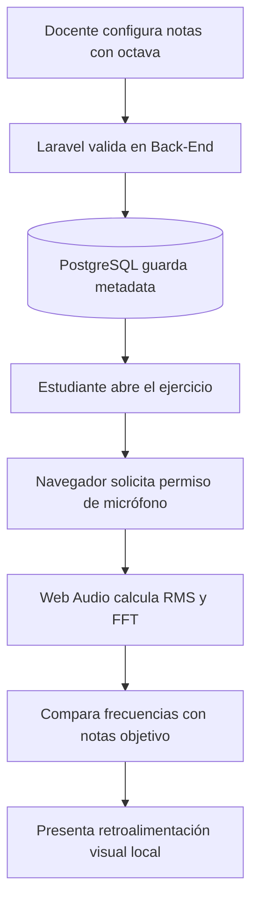

# Avance de audio y seguridad en ArmoníaLab

## 1. Objetivo

Este avance incorpora un prototipo educativo que escucha una disposición concreta de notas mediante el micrófono y entrega retroalimentación visual. También conserva los controles de autenticación, autorización, validación Back-End y protección de datos sensibles de ArmoníaLab.

El reconocimiento por micrófono no reemplaza la autocorrección del servidor: actualmente no crea automáticamente un intento, puntaje o registro de progreso.

## 2. Flujo general



Ejemplo almacenado en `metadata`:

```json
{
  "audio_captura": true,
  "audio_notas_objetivo": ["Do4", "Mi4", "Sol4"]
}
```

## 3. Arquitectura MVC involucrada

### Modelo

`app/Models/Ejercicio.php` convierte `metadata` a un arreglo mediante Eloquent. La información se almacena en PostgreSQL como JSON y forma parte del ejercicio.

### Controlador

`app/Http/Controllers/Admin/AdminEjercicioController.php` valida en el servidor:

- que el reconocimiento incluya entre 2 y 6 notas;
- que cada nota tenga nombre y octava entre 2 y 6;
- que se acepten sostenidos y bemoles, como `Fa#4` y `Sib3`;
- que no se configure dos veces la misma frecuencia mediante nombres enarmónicos.

### Vistas

- `resources/views/admin/ejercicios/create.blade.php`: activa el reconocimiento y recibe las notas objetivo.
- `resources/views/admin/ejercicios/edit.blade.php`: permite actualizar o desactivar la configuración.
- `resources/views/ejercicios/show.blade.php`: incluye el componente solamente cuando `audio_captura` está activo.
- `resources/views/components/audio-captura.blade.php`: solicita el micrófono, analiza la señal y muestra el resultado.

## 4. Funcionamiento del audio

1. `navigator.mediaDevices.getUserMedia()` solicita permiso para utilizar el micrófono.
2. `AudioContext` conecta el flujo con un `AnalyserNode`.
3. La raíz cuadrática media (**RMS**) mide el nivel de la señal en el dominio del tiempo.
4. Una **FFT de 8192 muestras** transforma la señal al dominio de la frecuencia.
5. Cada nota configurada se convierte a una frecuencia específica según su nombre y octava.
6. Se observa la energía alrededor del bin correspondiente a cada frecuencia.
7. El acorde se confirma después de seis lecturas completas consecutivas.
8. Al detener la captura, cambiar de página o cerrar la pestaña, las pistas del micrófono se liberan.

La octava es necesaria para reducir falsos positivos producidos por los armónicos. Por eso se configura `Do4, Mi4, Sol4` y no solamente `Do, Mi, Sol`.

## 5. Privacidad y seguridad del micrófono

- El navegador solicita permiso antes de acceder al dispositivo.
- El análisis se ejecuta en memoria dentro del navegador.
- No se crea ningún archivo de audio.
- No se transmite audio a Laravel, Render, Neon ni PostgreSQL.
- La aplicación libera el flujo mediante `track.stop()`.
- En producción se requiere HTTPS; Render proporciona esta conexión.

## 6. Seguridad de la aplicación

### Autenticación

`app/Http/Controllers/AuthController.php` valida las credenciales, regenera la sesión después del login e invalida la sesión al salir. Laravel limita a cinco intentos fallidos por combinación de correo e IP durante 60 segundos.

### Rutas protegidas y middleware

Las rutas protegidas utilizan `auth`. Las rutas administrativas se complementan con middleware de rol antes de llegar a los controladores. Ocultar un botón no constituye seguridad: un estudiante que escriba directamente una URL administrativa recibe una respuesta de acceso denegado.

### Validación Back-End

- `app/Rules/ValidEcuadorianCedula.php` aplica Módulo 10 a la cédula ecuatoriana.
- `app/Rules/ValidIntervalStructure.php` valida fórmulas de intervalos musicales.
- `AdminEjercicioController` verifica relaciones Curso → Lección y notas objetivo del reconocimiento.

### Datos sensibles

`app/Models/User.php` oculta `password`, `remember_token` y `cedula` durante la serialización. El administrador autorizado todavía puede consultar la cédula desde el modelo cuando la operación lo requiere.

## 7. Pruebas automatizadas

La suite actual contiene **66 pruebas y 218 afirmaciones**. Se ejecuta con:

```bash
docker exec armonialab php artisan test
```

Pruebas relevantes:

- `tests/Feature/AudioCapturaTest.php`: configuración, notas con octava, renderizado condicional y regresiones.
- `tests/Feature/AuthenticationTest.php`: login, logout, rutas protegidas y límite de intentos.
- `tests/Feature/RoleAuthorizationTest.php`: permisos de estudiante, docente y administrador.
- `tests/Feature/SensitiveDataExposureTest.php`: ocultamiento de credenciales y cédula.
- `tests/Feature/BackendValidationTest.php`: cédula e intervalos musicales.
- `tests/Feature/CascadingDropdownsTest.php`: relaciones dependientes verificadas en servidor.

## 8. Demostración para el profesor

### Configuración administrativa

1. Iniciar sesión como administrador o docente.
2. Entrar en **Panel Admin → Ejercicios**.
3. Crear o editar un ejercicio.
4. Activar **Reconocimiento de acorde por micrófono**.
5. Escribir `Do4, Mi4, Sol4`.
6. Guardar y explicar que Laravel valida las notas antes de persistirlas.

### Prueba como estudiante

1. Iniciar sesión como estudiante.
2. Abrir el ejercicio configurado.
3. Pulsar **Activar micrófono** y conceder permiso.
4. Mostrar el medidor RMS y el espectro.
5. Tocar la disposición configurada y observar las notas detectadas.
6. Mostrar el mensaje de acorde correcto después de mantener el sonido.
7. Detener la captura y comprobar que el navegador deja de usar el micrófono.

### Demostración de seguridad

1. Cerrar sesión e intentar abrir una URL protegida para comprobar la redirección al login.
2. Iniciar sesión como estudiante e intentar una URL administrativa para mostrar la autorización por rol.
3. Enviar notas sin octava, como `Do, Mi, Sol`, y mostrar el error del Back-End.
4. Ejecutar la suite de pruebas o mostrar su resultado.

## 9. Preguntas posibles y respuestas

**¿El audio se guarda en la base de datos?**

No. PostgreSQL guarda únicamente la configuración del ejercicio; el audio se procesa localmente y no se transmite.

**¿Qué diferencia hay entre RMS y FFT?**

RMS mide el nivel general de la señal. FFT permite observar cuánta energía existe en diferentes frecuencias.

**¿Por qué las notas llevan octava?**

Porque una misma clase de nota existe en muchas frecuencias. La octava permite comparar una frecuencia concreta y reduce confusiones por armónicos.

**¿La validación JavaScript es suficiente?**

No. JavaScript mejora la experiencia, pero Laravel vuelve a validar las notas en el servidor antes de guardarlas.

**¿El resultado del micrófono asigna puntaje?**

Todavía no. Es retroalimentación visual local; la autocorrección y los intentos persisten únicamente cuando se envía una respuesta al servidor.

**¿Cómo se protegen las URLs?**

Con middleware `auth` y middleware de roles, aplicados antes de ejecutar los controladores.

**¿Qué ORM utiliza el proyecto?**

Eloquent ORM, incluido en Laravel, para relacionar modelos y tablas PostgreSQL.

## 10. Limitaciones y siguiente paso

El resultado depende del ruido ambiental, la afinación, el instrumento y el micrófono. Es un prototipo educativo, no un afinador profesional. El siguiente incremento puede enviar únicamente las notas detectadas —no la grabación— al servidor para registrar el resultado como intento y alimentar el progreso personalizado.
